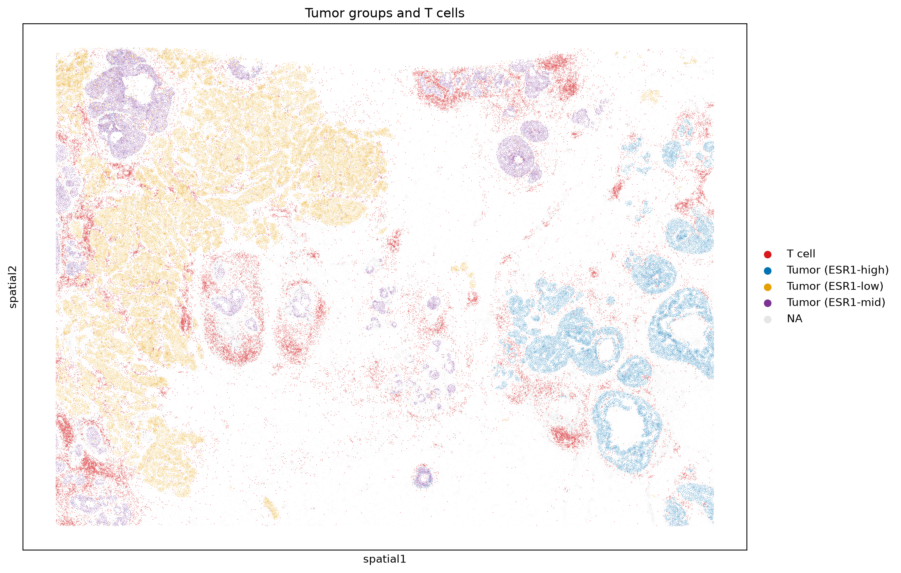
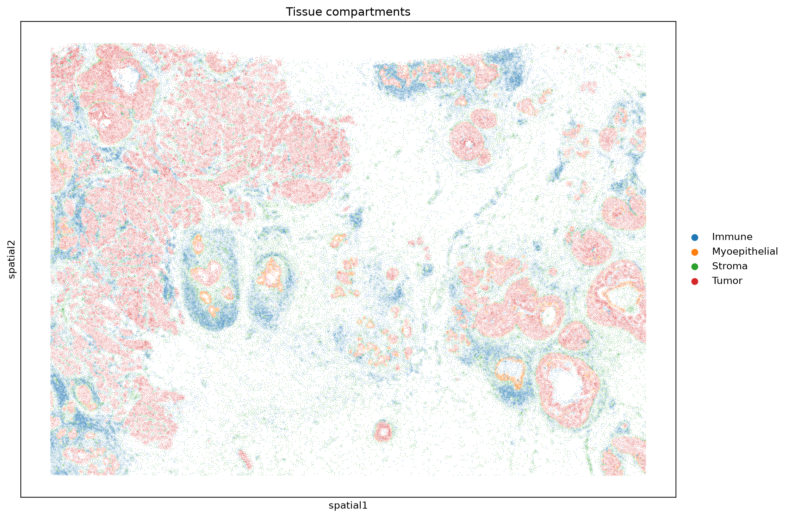
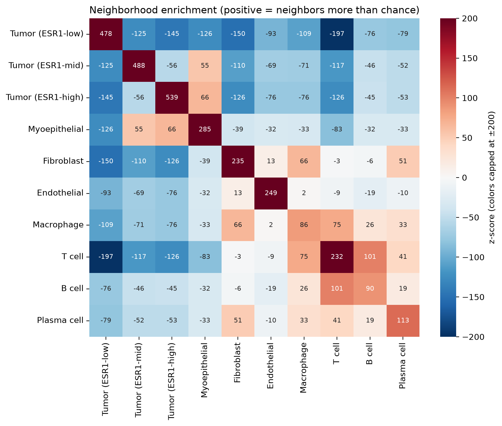

# Immune cells in the breast tumor microenvironment: a 10x Xenium analysis

A spatial transcriptomics analysis of one human breast cancer section, asking the question:

> **Do immune cells infiltrate the tumor, or are they held back in the surrounding stroma?**

I built this project to learn spatial omics end to end, from raw segmentation output to a spatial answer.



## Findings

In this section, immune cells mostly **surround the tumor rather than enter it**, a pattern often described as immune exclusion.

- Every immune cell type (T cells, B cells, plasma cells, macrophages) was found next to tumor cells **less often than expected by chance** (neighborhood enrichment, 200 label permutations).
- T cells sat a median of **~72 µm** from the nearest tumor cell, and only **16%** were within 20 µm. They gathered at tumor borders and in immune aggregates with B cells and macrophages.
- The degree of exclusion differed by region. Duct-like tumor nests wrapped by myoepithelial cells (DCIS-like) had the least T cell contact: **~25%** of tumor cells had a T cell within 30 µm. Invasive-like tumor sheets had more (**37%**). This ordering held at 20, 30 and 50 µm.

These results describe one section from one patient; see [Limitations](#limitations).

## What the notebook covers

| Part | Steps |
|---|---|
| 1. Tissue and segmentation | Loading a SpatialData object, viewing the DAPI image with cell outlines, measuring how much the default nucleus-expansion segmentation inflates cells |
| 2. QC and clustering | Choosing a transcript cutoff, control-probe noise, normalization, PCA, neighbor graph, Leiden clustering (with a resolution comparison), UMAP |
| 3. Naming the clusters | Marker dot plots, data-driven marker genes, splitting tumor cells by ESR1 level, checking my labels against the published annotation |
| 4. Spatial analysis | Neighborhood enrichment, distance to the nearest tumor cell, T cell contact per tumor cell in invasive-like vs DCIS-like regions |

After quality control, 164,000 cells were grouped into 11 clusters: three tumor groups (ESR1-high, -mid, -low), myoepithelial cells, fibroblasts, endothelial cells, macrophages, T cells, B cells, plasma cells, and one low-quality cluster. My labels agreed with the authors' published labels for 77 to 93% of cells in most cell types.




## Data

10x Genomics Xenium In Situ, FFPE human breast cancer, replicate 1 (313-gene panel, ~168,000 cells), from:

> Janesick, A. et al. High resolution mapping of the tumor microenvironment using integrated single-cell, spatial and in situ analysis. *Nature Communications* 14, 8353 (2023). https://doi.org/10.1038/s41467-023-43458-x

The data were downloaded as `xenium_rep1_io` from the [SpatialData example datasets](https://spatialdata.scverse.org/en/stable/tutorials/notebooks/datasets/README.html) (CC BY 4.0). The published cell type labels used for comparison are read directly from a URL inside the notebook. The data are not included in this repository (~3.4 GB).

## How to run

1. Create the environment:

   ```bash
   conda create -n spatial python=3.11
   conda activate spatial
   pip install -r requirements.txt
   ```

2. Download `xenium_rep1_io` from the link above, unzip it, rename the folder to `xenium.zarr` and place it in `data/`.

3. Open `notebooks/xenium_breast_analysis.ipynb` and run all cells. An internet connection is needed for the published labels. Figures are written to `figures/`, and two checkpoints (`adata_processed.h5ad`, `adata_annotated.h5ad`) to `data/`.

The notebook was run with Python 3.11, scanpy 1.11.5, squidpy 1.8.2, spatialdata 0.7.3, anndata 0.12.19 and SciPy 1.14.1. It includes a small compatibility fix for `sc.pp.neighbors` with recent SciPy versions (explained in the notebook).

## Repository structure

```
xenium-breast-tme/
├── notebooks/
│   └── xenium_breast_analysis.ipynb   # the full analysis, top to bottom
├── figures/                           # figures saved by the notebook
├── data/                              # not tracked; place xenium.zarr here
├── requirements.txt
└── README.md
```

## Limitations

- **One section, one patient.** The results describe this sample, not breast cancer in general, and no statistical test was applied to the regional differences.
- **Segmentation.** This dataset has a nuclear stain only, so cell outlines are nuclei expanded outward. In sparse tissue they inflate, and transcripts from neighbors can spill into a cell, which may blur identities right at the tumor–immune borders being measured.
- **Annotation.** Labels come from a 313-gene panel and marker genes. Normal luminal cells share markers with ER-positive tumor cells, so some normal epithelium is likely included in the tumor groups.
- **ESR1 groups are relative, not clinical ER status.** Linking them to DCIS-like and invasive-like regions rests on spatial patterns (myoepithelial rings, tissue architecture), not on pathology review.

## Possible next steps

- Re-segment with a transcript-aware method (e.g. Baysor or Proseg) and test whether the immune-exclusion result holds.
- Repeat on the second replicate section (`xenium_rep2_io`).
- Compare with pathologist annotations of DCIS and invasive regions.

## Tools

[SpatialData](https://spatialdata.scverse.org/), [spatialdata-plot](https://spatialdata.scverse.org/projects/plot/), [scanpy](https://scanpy.readthedocs.io/), [squidpy](https://squidpy.readthedocs.io/), SciPy, pandas, matplotlib, seaborn.